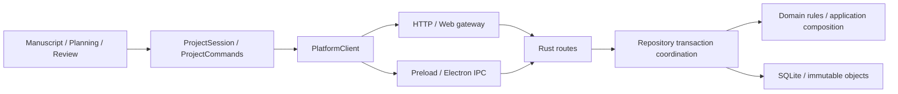

# Current architecture

SceneSparrow / 幕雀 is a local-first manuscript workbench with one Rust core,
SQLite project storage, a shared React interface and supervised Node workers.
The browser and Electron use the same application UI and protocol. A private Web
deployment serves one operator workspace; it does not isolate multiple users.

This document maps the implemented source. Product requirements and historical
choices remain in the [design index](design/README.md),
[stage specifications](specs/README.md), [decisions](decisions/) and
[original references](reference/README.md). The
[architecture cleanup evidence](validation/architecture-cleanup.md) records the
ownership refactor; it does not establish new product or platform acceptance.

## Runtime and dependency boundaries

| Owner                      | Implemented responsibility                                                                                                                                       |
| -------------------------- | ---------------------------------------------------------------------------------------------------------------------------------------------------------------- |
| `apps/web/src`             | Mounts the shared UI and selects the HTTP or desktop client. Its built renderer is also used by Electron.                                                        |
| `apps/web/server`          | Production Web startup/shutdown, operator authentication, exact-origin gateway, static assets and bounded diagnostics. Core credentials stay server-side.        |
| `apps/desktop/src`         | Owns the current core process, window and session; authorizes named IPC capabilities and coordinates project switching and native delivery.                      |
| `packages/editor-ui`       | Presentation, local input buffers and one project command/session owner.                                                                                         |
| `packages/platform-client` | Stable typed client API with separate HTTP and desktop adapters, event transport and classified errors.                                                          |
| `crates/service`           | Authenticated HTTP/SSE, input/response mapping, bounded blocking execution and background job startup.                                                           |
| `crates/application`       | Infrastructure ports, project metadata services/validation and business-owned AI input/schema composition.                                                       |
| `crates/domain`            | Pure project/manuscript/planning/review rules and generated protocol types.                                                                                      |
| `crates/infrastructure`    | One project repository and writer coordinator, SQLite transactions, immutable objects, receipts/history, business execution, credentials and worker supervision. |
| Node workers               | Read versioned inputs and return extraction, export or AI results. They never write authoritative project state.                                                 |

Rust dependencies remain `application -> domain`,
`infrastructure -> application + domain`, and
`service -> application + infrastructure + domain`. Domain and application do
not depend on Axum, SQLite, Electron or machine-specific storage.

`ProjectService` handles project metadata operations. Manuscript, planning,
review and delivery routes call the concrete repository's transaction-aware
operations; they do not pass through a redundant project-metadata facade API.
Pure rules stay in domain, and business AI composition stays in application.

JSON Schema in `packages/contracts/schema/` is the protocol source of truth.
Generated TypeScript and Rust types are checked together. The pure
`packages/manuscript-format` writer is shared by the editor's Markdown projection
and the document exporter. Shared AI configuration/execution remains independent
of manuscript rules; business consumers own context, scope and application.

## Source map

```text
apps/
  web/
    src/main.tsx                 # Shared renderer entry
    server/                      # Production Web runtime
  desktop/src/
    main.ts                      # Process/window/session and project lifecycle
    preload.cts                  # Named renderer capabilities
    ai-ipc.ts                    # AI IPC routes
    export-ipc.ts                # Export/copy IPC and capability lifetimes

packages/
  editor-ui/src/
    index.tsx                    # Public App export
    app/                         # Bootstrap, project entry and global settings UI
    workbench/                   # Mounted workspace, panes and view coordination
    project-session/             # Command queue, revisions, receipts and history
    manuscript/                  # Tiptap setup, canonical projection and import UI
    planning/                    # Outline/input buffer, generation and task views
    review/                      # Selection, conversation, candidates and lock UI
    library/                     # References and evidence selection
    delivery/                    # Copy/export presentation
    ai-settings/                 # Global model services and credentials UI
    feedback/                    # Owned notices and error presentation
    ui/                          # Reused dialog, focus and icon primitives
    locales/                     # English and Simplified Chinese catalogs
    app-preferences.ts           # Global application save preferences
    styles.css                   # Shared presentation
  platform-client/src/
    index.ts                     # Public API exports
    types.ts                     # Client and named desktop bridge contracts
    http.ts                      # Browser adapter
    desktop.ts                   # Preload adapter
    events.ts                    # HTTP event stream and cursor replay
    errors.ts                    # Business and transport error types
    transport.ts                 # HTTP response validation/classification
    links.ts                     # External-link validation used by both adapters
  contracts/                     # Schemas and generated TypeScript types
  manuscript-format/             # Pure shared Markdown writer
  ai-runtime/                    # Generic provider runtime and output guards
  video-runtime/                 # Separate Remotion sample

crates/
  service/src/
    lib.rs                       # State, auth, project bootstrap and blocking gate
    routes/                      # Named HTTP/SSE modules
    jobs.rs                      # AI/reconciliation/maintenance and export loops
  application/src/               # Ports, metadata services and business prompts
  domain/src/                    # Pure rules and generated contracts
  infrastructure/src/
    lib.rs                       # Repository lifecycle and shared writer ownership
    storage/                     # DB errors, hashing, immutable objects and retention
    worker_process.rs            # Common document-process mechanisms
    manuscript.rs                # Canonical command transaction coordination
    history.rs                   # Bounded project history
    planning.rs                  # Planning persistence and generation consumer
    review.rs                    # Review persistence and candidate application
    finalization.rs              # User locks and derived approved baseline
    documents.rs                 # Intake, parsing and import jobs
    exports.rs                   # Copy/export snapshots, artifacts and delivery records
    ai/                          # Settings, durable execution and framed AI host
    credentials/                 # Platform/session/encrypted credential adapters
    backup.rs                    # Verified backup and recovered-copy operations

workers/
  agent/                         # Supervised AI process host
  document/                      # Extraction, visual preparation and serializers
  render/                        # Supervised data-only video project and render sample
scripts/
  web/                           # Deployment/operator configuration and smoke tools
  release/                       # Version and release-policy tooling
tests/
  unit/                          # Pure behavior, adapters and injected lifecycle tests
  integration/                   # Real core HTTP workflows
  e2e/                           # Browser interactions and production-gateway checks
```

## Input, commands and rendering

`App` loads or ensures the project and mounts `Workbench` by project identity.
The mounted workspace creates exactly one `ProjectSession`. It owns the command
queue, canonical revision, unresolved receipts, body save coordination and project
history. `PlanningAutosave` keeps its own planning buffer and participates in that
same queue through the existing planning adapter. `ProjectCommands` retains each
caller's pending command identity; changing UI context cannot replace an uncertain
request with a new paid or mutating action.

The session keeps each pending control command with its original visible-input
snapshot and owns the pure local/canonical body comparison. Content equality
does not settle unsaved history checkpoints. Body edits, metadata cancellation
and caller intent retain their separate lifetimes.

`useManuscriptEditor` owns Tiptap configuration, paste/keyboard/IME handling,
identity repair and local-to-canonical conversion. Workbench owns pane/view
presentation, recovery/close decisions and mounting. Outline and manuscript
surfaces stay mounted while hidden and inert, preserving their local input.
Shared data-only view/save types live in leaf modules, and reusable dialogs/icons
do not depend on a specific feature component.



The diagram traces project write/final-input actions. Read-only presentation and
global settings use their named client methods without entering the manuscript
write queue. HTTP and desktop adapters preserve the same capability surface;
the desktop bridge does not expose a generic request, IPC-channel or filesystem
API. External navigation uses explicitly validated links.

## Background work and storage

`service/jobs.rs` starts the independent AI/reconciliation/maintenance loop and
export loop. HTTP modules do not own these loops. Durable AI execution records
dispatch intent before calling the framed agent worker; consumer-specific
reconciliation validates results before application. Ambiguous dispatch never
causes an automatic provider retry.

Document extraction, visual preparation and export share only process startup,
child reaping and RSS sampling through `worker_process`. Their owners retain
attempt/cancellation checks, deadlines, output bounds, protocol validation and
error mapping. The framed AI worker retains its separate credentials, artifact
transfer and dispatch protocol.

All authoritative writes use the existing repository connection/writer
coordinator. Domain planning rules calculate node revisions from current content,
position and stored high-water tokens; infrastructure reads those tokens through
the existing per-node adapter. `storage/objects.rs` promotes verified immutable bytes;
`storage/retention.rs` traverses retention roots and collects unreferenced objects.
Root capture, metadata pruning and collection share the writer lock with object
preparation. Collection commits metadata before unlinking bytes. The
operation-scoped verification cache remains inside storage and rechecks file
identity/size/time before reuse. Backups pin verified objects from a consistent
snapshot; copying a live SQLite main file alone is not a backup.

User projects live outside the source checkout. Source-local `.local/`,
`.runtime/` and `.artifacts/` hold ignored test/development outputs. Applied
migrations remain immutable and new versions are append-only.

## Delivery and verification

The container starts `apps/web/server/start.mjs`; deployment and smoke commands
remain in `scripts/web/`. Electron owns current-process checks and exact
sender/main-frame/entry-URL validation. Native copy/export capabilities settle
before project shutdown or switching and clear replay state at that boundary.

Use [development setup](development.md) and the
[Web deployment runbook](web-deployment.md) for runnable commands. Validation is
recorded under [validation/](validation/), with PR `foundation` checks on the
current merge commit. Linux/browser/mock-provider results do not certify real
Windows/macOS, native credential stores, live providers or unmet large-document
performance budgets. The file-backed Web workspace also exposes a bounded video project: native official
skill loading supplies context through the text Agent transport, the core adopts
validated composition data, and a supervised renderer bundles the trusted shipped
TypeScript template. See [video project boundaries](video-projects.md). Arbitrary
generated code execution remains disabled until platform isolation is implemented
and tested.

## Web writing runtimes

The Web application owns the Agent session and guarded Markdown writer.
`crates/infrastructure/src/codex_agent.rs` connects to a private Unix socket.
The isolated Linux runner launches Codex App Server over stdio with separate
credentials and scratch space. The authenticated catalog checks the account
and models. [Runner guide](codex-writing-runner.md)

The [DeepSeek runner](deepseek-writing-runner.md) runs pinned native ACP with
a writing-only profile. The Linux Web release pairs the two images and shares
one private socket volume with the runner. The Web supervisor owns the fixed
DeepSeek Messages relay. Web readiness is independent of runner connectivity.
The native adapter uses the existing vault and document write boundary.
