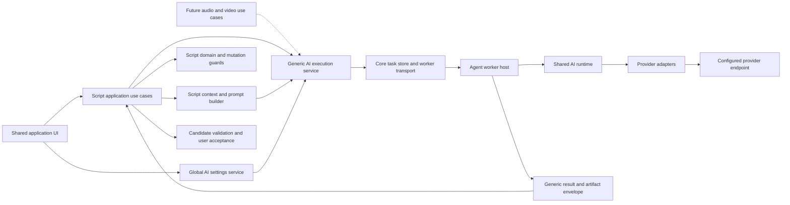
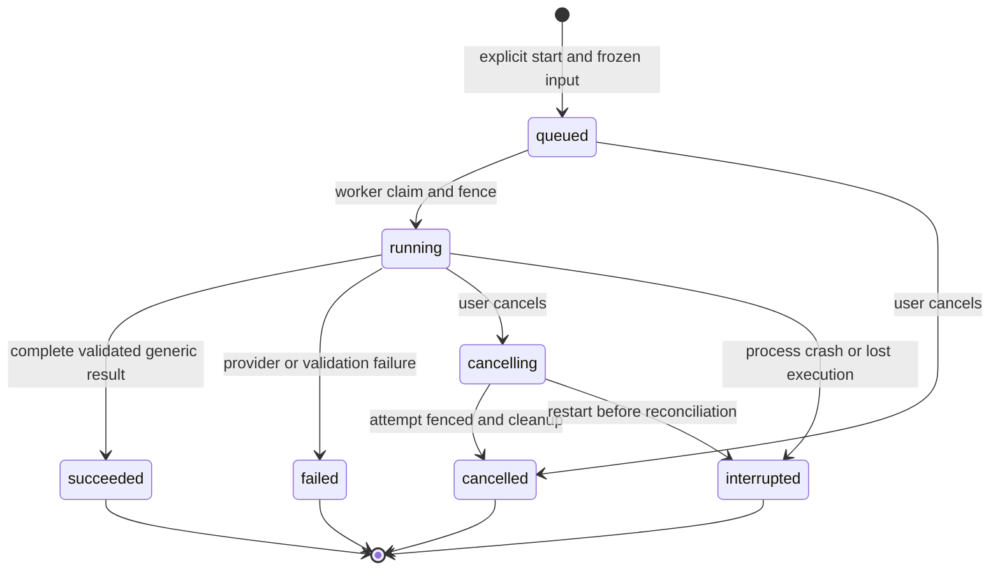

# Shared AI technical design, v0.1

Status: proposed implementation design. No provider adapter, secret store, task
queue, or production generation flow is implemented by this documentation change.
Read with the [script workbench design](script-workbench-v0.1.md).
The [shared AI implementation spec](../specs/shared-ai-integration.md) refines
these boundaries into concrete ports, dispatch guards, secure-store behavior,
migration order, development tasks and acceptance cases. Those are specifications,
not implemented features or measured test results.

## 1. Purpose and separation

Provide one reusable AI execution capability for manuscript work now and audio and
video work later. Reuse configuration, credentials, provider adaptation, request
execution, events, cancellation and error handling. Keep business meaning in the
calling domain: the shared runtime must not know what a paragraph lock, a review
comment, manuscript finalization, a storyboard, or a rendered shot is.



The core remains the only writer of authoritative project state. The worker
produces typed outputs and temporary artifacts; the caller's application service
interprets them and submits validated business commands. Provider success means
only that an execution returned output, not that a manuscript was accepted or a
production stage passed.

## 2. Ownership and dependency rules

| Concern                                                        | Owner                                                         | Must not depend on                                |
| -------------------------------------------------------------- | ------------------------------------------------------------- | ------------------------------------------------- |
| Paragraphs, comments, review, locks, candidate acceptance      | Script domain/application                                     | Provider SDK, provider-specific response shapes   |
| Context selection, source evidence, text prompts/output schema | Script application                                            | Concrete provider client                          |
| Provider records, model catalog, category bindings             | Global AI settings service                                    | Project-specific model configuration              |
| Durable run/attempt state, scheduling, fences                  | Generic core execution service                                | Script readiness or comment status                |
| Normalized messages, capabilities, provider calls              | Shared AI runtime                                             | Editor UI, script domain, Remotion                |
| Credentials                                                    | Platform credential adapter and controlled execution boundary | Project files, renderer storage                   |
| Search results and source discovery                            | Independent source-discovery port/adapters                    | Implicit website crawler                          |
| Rendering and media processing                                 | Future render/media execution ports                           | Chat-completion transport as a universal executor |

Proposed organization:

```text
crates/domain/src/ai/                 # Generic run IDs, capabilities, states
crates/application/src/ai/            # Configuration and execution ports/use cases
crates/application/src/script/ai/     # Script prompts, context, output interpretation
crates/infrastructure/src/ai/         # Settings, task persistence, worker transport
crates/infrastructure/src/credentials/
packages/contracts/schema/ai/        # Shared execution DTO schemas
packages/contracts/schema/script/    # Script-only commands/candidate DTO schemas
packages/ai-runtime/src/             # New reusable Node/TypeScript library
  adapters/openai-compatible/
  capabilities/
  messages/
workers/agent/src/                   # Thin process host for ai-runtime
```

Paths are planned, not created by this change. `packages/ai-runtime` may depend
on generated generic contracts and provider SDKs. It must not import `editor-ui`,
`video-runtime`, script prompts, or project repositories. Rust domain/application
code declares ports; infrastructure supplies process/secret/storage implementations.
The current `AgentProvider` bootstrap interface is provisional: do not expose its
script-scope `allowedObjectIds` as provider semantics. Keep allowed scope in the
calling business task binding, and evolve the worker protocol into generic requests.

Add dependency checks when implementation introduces these packages. Test the
runtime with a fake caller using opaque input references, so reuse does not depend
on constructing a manuscript. No separate AI server, microservice fleet, or second
business database is required.

## 3. Global configuration

### 3.1 Categories and capabilities

The application exposes exactly three coarse category bindings. Model capabilities
are separate from those user-facing categories.

| Category | Intended tasks                                                                            | v0.1 behavior                                                           |
| -------- | ----------------------------------------------------------------------------------------- | ----------------------------------------------------------------------- |
| `text`   | Topic work, source-assisted planning, outlines, draft generation, questions and revisions | Implement one shared text binding                                       |
| `audio`  | Future speech/voice generation                                                            | Reserve the category; no working synthesis UI/adapter yet               |
| `video`  | Future generation of scene descriptions and video scripts/code                            | Reserve separately from audio; rendering remains Remotion/Chrome/FFmpeg |

A later video script task can request `text.generate` using the **video** category's
model. Audio can request a future `audio.synthesize` capability through a different
adapter. Neither scenario requires the manuscript domain or changes to text
workflow rules. This separation does not promise that every provider supports all
capabilities or that a chat endpoint can synthesize audio/video.

There are no project-level model overrides and no separate models for outlining,
review, and prose in v0.1. An operation may use different prompt/output constraints
while retaining the same resolved text category configuration.

### 3.2 Configuration records

| Record             | Fields                                                                                                |
| ------------------ | ----------------------------------------------------------------------------------------------------- |
| `ProviderProfile`  | ID, label, adapter kind, normalized base URL, auth mode, credential reference, configuration revision |
| `ModelEntry`       | Provider ID, model ID, display label, capability declarations, discovery/verification metadata        |
| `CategoryBinding`  | Category, provider ID, model ID, validated common parameters, revision                                |
| `ExecutionPolicy`  | Concurrency, request/idle timeout, response/context limits; no automatic fallback policy              |
| `ResolvedAiConfig` | Exact provider/model/category/parameters/adapter version and revisions frozen for one execution       |

Store application-wide nonsecret settings in an atomically written, versioned
settings file in the platform's application-data directory. This is separate from
project storage and avoids adding another business database. Validate a complete
new settings document before atomic replacement and preserve the prior valid
configuration on failure. Project task records retain a redacted resolved snapshot
for reproducibility; they do not become editable per-project model settings.
Serialize settings writes with an application-level file lock and expected settings
revision, so switching projects or running another local instance cannot silently
overwrite the global configuration.

Normalize the base URL as an API root without hardcoding an extra `/v1`. Presets
can include the correct path for compatible endpoints. Support custom endpoints,
including explicitly configured local providers; preserve TLS verification for
HTTPS. Do not send credentials to a different redirect origin automatically.
Validate URLs and reject credentials embedded in their user-info/query components.

Support model discovery when `/models` works and manual model IDs when it does not.
Failure to enumerate models must not prevent testing a manually configured model.
Capability metadata uses `supported`, `unsupported`, or `unknown`, with its evidence
source. A model list/name is not evidence of image, streaming, or structured-output
support. User declarations can enable an attempt, while the actual result/error
remains authoritative. Show capabilities honestly rather than silently claiming
all compatible endpoints behave identically.

### 3.3 Task-start snapshot and retry

Define task start as successful acceptance of the user's explicit start command,
before placement in the queue. Resolve and freeze category binding, model, base
URL, parameters, prompt version, input references, capability declarations and
configuration revisions at that boundary. Settings changes do not alter queued
or running tasks. A credential revision reference is pinned as well; raw secrets
are not stored in the project snapshot.

On credential rotation, an already issued in-memory lease may finish; a queued
run whose pinned credential revision is unavailable fails with a settings tip.
Never silently replace its credential or endpoint. This is an engineering default
for preserving task-start semantics, not a requirement to archive deleted secrets.

Manual retry creates a new run with `retryOfRunId`, fresh input validation and a
new snapshot of the current global configuration. The UI shows that the new
settings will be used. Keeping the earlier run immutable avoids changing the
meaning of its audit data. Attempt numbers within a run identify worker claims
and fence stale receipts; they do not authorize automatic paid resubmission.

## 4. Provider adapter strategy

### 4.1 First adapter

Implement OpenAI-compatible Chat Completions first, using the official JavaScript
SDK behind the local adapter (pin a tested version at implementation). Keep SDK
types inside that adapter. Set SDK automatic retries to zero (`maxRetries: 0`) and
disable equivalent application/provider-wrapper retry loops. A timeout, rate
limit, unsupported parameter, authentication failure or model failure produces
a typed failure and waits for the user's action.

Streaming is optional transport capability. Normalize streaming chunks and a
non-streaming response into the same application event contract. Decide request
mode from the frozen configuration; do not make a second paid request to silently
try non-streaming after a streaming failure. Similarly, do not retry with removed
parameters, switch models or providers, or automatically repair invalid JSON by
calling another model. Omit unsupported optional parameters before the first call
when their capability is known.

Use native JSON-schema output only if supported; otherwise request structured
JSON in the prompt and parse it once through the caller-supplied schema. A
malformed/truncated response is a failure or non-applicable result, not a partially
accepted manuscript. Streaming previews are transient and never executable code.
Tool calling, embeddings and vendor-native APIs are not prerequisites for the
initial manuscript workflows.

### 4.2 BiliNote reference and limits

The reference inspection used BiliNote commit
`90940fde4d224d0f69ad99674f4af0a1ea52d3c4`:

- [GPT factory](https://github.com/JefferyHcool/BiliNote/blob/90940fde4d224d0f69ad99674f4af0a1ea52d3c4/backend/app/gpt/gpt_factory.py)
  routes configurations to one compatible provider and a universal GPT wrapper.
- [Client construction](https://github.com/JefferyHcool/BiliNote/blob/90940fde4d224d0f69ad99674f4af0a1ea52d3c4/backend/app/utils/openai_client.py)
  uses the Python OpenAI client with a configurable base URL and API key.
- [Provider presets](https://github.com/JefferyHcool/BiliNote/blob/90940fde4d224d0f69ad99674f4af0a1ea52d3c4/backend/app/db/builtin_providers.json)
  illustrate OpenAI, DeepSeek, Qwen-compatible, Gemini-compatible, Groq and local
  Ollama endpoints. A listed Claude placeholder is not a working native adapter.
- [Model service](https://github.com/JefferyHcool/BiliNote/blob/90940fde4d224d0f69ad99674f4af0a1ea52d3c4/backend/app/services/model.py)
  illustrates discovery/manual model handling.
- [Connection test](https://github.com/JefferyHcool/BiliNote/blob/90940fde4d224d0f69ad99674f4af0a1ea52d3c4/backend/app/gpt/provider/OpenAI_compatible_provider.py)
  makes a real small completion instead of treating model enumeration as proof
  of inference access.

Adopt the provider/model/configuration pattern, not BiliNote's Python application,
plain-key storage patterns, retry behavior, or business workflows. Its popularity
does not establish endpoint compatibility. Recheck preset URLs when implementing;
real credentials and a selected model are needed for an actual connection test.
The current [model-services design](ai-model-services.md) limits new-service
presets to OpenAI and DeepSeek; this broader BiliNote list remains reference data.
Use a small supported output budget, not universally hardcoded temperature/token
parameters. A successful text test proves neither vision nor all other capabilities.
Any copied code must preserve the applicable MIT notice; this design copies no
implementation code.

## 5. Generic contracts

Define JSON Schema as the source of truth and generate public Rust/TypeScript
representations. The following are logical shapes, not competing hand-written DTOs.

### 5.1 Request envelope

| Field                                 | Meaning                                                              |
| ------------------------------------- | -------------------------------------------------------------------- |
| `runId`, `attempt`, `protocolVersion` | Execution identity and worker protocol negotiation                   |
| `category`, `capability`              | Global configuration category and requested operation                |
| `inputSnapshotId`                     | Opaque immutable input identity; not a manuscript ID contract        |
| `resolvedConfig`                      | Nonsecret frozen provider/model/parameter configuration              |
| `credentialLeaseId`                   | Opaque restricted reference, resolved only in the execution boundary |
| `messages`                            | Normalized role and content parts for text-capable operations        |
| `inputArtifacts`                      | Scoped content references with MIME type, hash and size              |
| `outputSpec`                          | Expected MIME type/schema ID/schema version and size budget          |
| `limits`                              | Deadline, maximum output bytes and allowed generic capabilities      |
| `traceId`                             | Correlation without prompt/secret logging                            |

Text content parts are text or referenced images with provenance and size metadata.
Do not treat a URL in ordinary text as a request for the runtime to fetch it. Local
artifact references are resolved through a scoped input broker; never send a local
filesystem path as an image URL or grant an arbitrary-path read API to the worker.
When supported, images may be encoded as provider-compatible bytes/data URLs by
the adapter within the configured limits.

Text operation bodies are a discriminated variant. Reserve capability identifiers
for future audio/code workflows without pretending their request bodies already
have a complete schema. Add new versioned operation variants when those designs
exist; do not accumulate audio/video-specific optional fields on a text request.

The business binding separately stores manuscript/thread IDs, request version,
allowed patch scope, context dependency revisions, prompt version and output
interpreter version. The provider/runtime does not interpret those fields and
cannot use them to unlock or accept anything.

### 5.2 Events and results

Normalize events to `started`, `output_delta`, `progress`, `usage`, and one terminal
`completed`, `failed`, or `cancelled` event. Core-facing events include run/attempt,
monotonic event sequence and protocol version. Provider request IDs are optional
diagnostic fields, not primary task identities. Usage may be unknown; do not invent
token counts or a price estimate when the provider supplies no reliable data.

The result envelope contains the input snapshot ID, output artifacts/content,
output schema/version, finish reason, optional usage and safe provider metadata.
It contains no `approved`, `unlock`, `resolveComment`, or `finalizeProject` command.
The caller performs its own output validation even if provider-native structured
output reported success. Reject missing/truncated output and invalid artifact hashes.

Use a bounded, length-prefixed or line-framed JSON protocol over dedicated child
process pipes. Reserve stdout for the protocol and stderr for redacted diagnostics.
Validate frame sizes and schema versions at both ends. Large outputs use staging
artifacts plus manifests, not unlimited IPC frames. The core validates and promotes
those artifacts before recording successful completion. Contract evolution must
keep the UI, core, worker and generated types in one tested repository change.

## 6. Task lifecycle and persistence



Terminal result versus cancellation is decided atomically by the core. If result
commit won first, cancellation returns the already-completed state. If cancellation
revoked the attempt first, later output cannot become an applicable result. A
business candidate remains a separate review object after a successful run.

Persist generic `ai_runs`, `ai_attempts`, `ai_dispatches`, `ai_input_snapshots`,
`ai_artifacts`, `ai_events`, and worker-ownership leases in the existing project
database. Consumer modules own paragraph-use reservations separately. Keep
script-specific run associations in the script module. Configuration/model connection tests are
app-scoped ephemeral executions and do not pollute project undo/history.

Each worker claim has an attempt number and unforgeable fence token. Check run ID,
attempt, fence, input snapshot and terminal state before accepting receipts. Accept
the same completed receipt idempotently; reject altered duplicates or old attempts.
Persist terminal state, promoted result references and core event in one transaction.
Release associated business reservations through the application coordinator.
Commit a unique dispatch marker before the worker can issue generation; an
ambiguous dispatch is never sent again for the same run. Configuration/run creation
and consumer binding/reservation use the shared spec's coordinated unit of work.

For a first implementation, use one running AI request per project, one active
revision task per overlapping block scope, and a small bounded queue (initially
eight pending requests). Expose queued/running states and cancellation. This is an
engineering default, not a tenant scheduling system. Increase concurrency only
after measuring provider limits, memory and UI behavior.

Never hold a database write transaction across a provider call. Heartbeats detect
worker liveness, not provider success. After restart, preserve durable succeeded
results and queued snapshots. In the known original database only, queued work
known never claimed/dispatched may continue with its original config. Lost claimed
or previously running/ambiguous work becomes `interrupted` and awaits explicit
retry; it must not be automatically resubmitted.
Recovered/unknown-origin project copies fence all copied nonterminal runs, even
queued ones: an old backup cannot prove what executed afterward in the original.

Cancellation aborts the HTTP request and fences later receipts. The core may then
release its local scope lease because the worker cannot write project state.
Remote providers may already have consumed work and may not guarantee refund or
immediate stop; report cancellation without promising remote billing reversal.
Retain only bounded safe diagnostics and necessary artifacts. Never restart a
cancelled request merely because the connection later reconnects.

## 7. Context and output integration

The script application owns these logical workflows:

| Workflow                      | Input composition                                                            | Domain result                                |
| ----------------------------- | ---------------------------------------------------------------------------- | -------------------------------------------- |
| Outline generation/adjustment | Brief, current outline, selected source evidence, overall instruction        | Validated planning outline                   |
| Initial draft                 | Confirmed outline, brief, selected evidence                                  | Complete canonical draft, initially unlocked |
| Question                      | Quoted selection, bounded context, thread/request version, relevant evidence | Answer attached to its thread                |
| Revision note                 | Target range, current body dependencies, instruction, relevant evidence      | Scoped candidate patch for user review       |

Version prompts and output schemas under the script application. Make target
language and requested tone explicit. Supply only relevant source excerpts and
nearby manuscript context within a deterministic budget. Expand context deliberately
when needed; never send every file by default. Record which evidence was included,
omitted or truncated. Keep source metadata and model-generated conclusions separate.

Check estimated context/output limits before dispatch where possible; token
estimates vary across compatible providers. If a request cannot fit, explain how
to reduce sources/length or change configuration. Do not silently truncate the
required target/outline or claim a complete draft after an output-limit finish.

External documents, comments and model text are data, not application privileges.
The first implementation executes no model-generated shell, JavaScript, Python,
or SQL. Parse only the expected structured text result. Application validation,
not prompt wording, enforces the actual patch scope and lock rules.

On completion, the script interpreter validates the result and current dependency
versions. A successful question attaches an answer; a successful revision creates
a pending candidate. Neither closes the review thread automatically. A late answer
to an edited/deleted request is stale and must not resolve its newer version. The
core may retain it as labeled evidence without changing current review state.

## 8. Source discovery and multimodal capability

Define `SourceDiscoveryPort.search(query, limits)` separately from text generation.
Its results contain URL, title, snippet, provider and retrieval time, with no
downloaded website body. A configured adapter may use an explicitly supported
search API or provider search capability. Plain Chat Completions is not assumed
to have web access. Do not present model-invented URLs as verified search results.

Manual links and local/uploaded sources always work. Discovery is enabled only
when a working search capability is configured and tested. The initial compatible
text adapter alone does not promise live search; a search integration can be added
without changing script review or provider configuration ownership. If unavailable,
show the capability as unavailable and accept user-provided links/files.

Image support is likewise explicit. Validate selected image count/size and provider
input capability before submission. If unknown or unsupported, explain the missing
input support and let the user select a capable model or knowingly use text-only
evidence. Do not silently drop images and describe them as read. Image extraction
and PDF text parsing belong to document intake, not to the text provider adapter.

## 9. Credentials and local process boundaries

Use a `CredentialStore` port with Windows Credential Manager and macOS Keychain
adapters, for example through a maintained Rust `keyring` implementation after
platform validation. Global settings retain opaque references only. Do not store
raw API keys in project databases, source snapshots, source control, localStorage,
URLs, logs, command-line arguments, or task exports.

The shared UI may accept an initial key entry, send it through the restricted
settings operation, then clear it. Settings queries return masked presence/status,
not the saved secret. Browser development uses authenticated loopback transport;
an explicit `SCENESPARROW_AI_MASTER_KEY_FILE` selects the AES-256-GCM encrypted-file
adapter described in [model services](ai-model-services.md). It retains private
versioned ciphertext revisions and an authenticated header under app-data, with
the 32-byte base64 master outside project/app-data backups. Wrong or missing keys
never downgrade an existing vault to memory/plaintext; isolated entry corruption
makes only that credential unavailable. Ordinary nonnative development with neither
a configured master nor existing encrypted data uses labeled session memory.
Views distinguish native, encrypted-file and session-only persistence. The private
Web deployment provisions one host master and reuses it across builds/restarts;
backup/restore of that key is separate from app-data archives. Native adapters
still require actual Windows/macOS verification.

Resolve a credential lease immediately before execution and pass it through a
dedicated controlled pipe/message to the worker, never through a shell command or
logged environment. Scope it to the run/provider endpoint and drop retained values
on completion as far as the language runtime permits. JavaScript memory cleanup
is not a claim of cryptographic zeroization. Revocation and secret-store failures
become explicit typed failures.

Support explicit `authMode = none` for an intentionally configured local keyless
provider; do not require a fictitious stored user key. The adapter may supply any
SDK-required nonsecret placeholder internally without representing it as a secret.
No multitenant identity/RBAC system is introduced. Single-user deployment still
requires task scope checks, authenticated local IPC and controlled credential access.

A worker process boundary alone is not a sandbox. Keep arbitrary generated-code
execution disabled. The trusted runtime receives scoped inputs and no database
API; future executable video scripts require their own tested isolation design.

## 10. Errors, observability, and acceptance

Normalize errors as `AUTH_REQUIRED`, `AUTH_REJECTED`, `MODEL_UNAVAILABLE`,
`CAPABILITY_UNSUPPORTED`, `RATE_LIMITED`, `CONTEXT_LIMIT`, `OUTPUT_TRUNCATED`,
`NETWORK_FAILED`, `REQUEST_TIMEOUT`, `INVALID_OUTPUT`, `WORKER_INTERRUPTED`,
`CANCELLED`, and `CREDENTIAL_UNAVAILABLE`. Return safe details, correlation ID,
and suggested user actions. Keep model failure tips visible in the task and
review context; do not rely on an untraceable disappearing toast.

Separate transport/provider failure from domain rejection such as
`CANDIDATE_STALE` or `PATCH_OUT_OF_SCOPE`. A user can edit settings and manually retry;
the application does not choose another provider/model. SDK retries, adapter retry
loops, and job recovery must all obey this same rule.

Record duration, queue time, provider/model identity, operation category, safe error
code, output size and reported usage. Do not log raw prompts, keys, extracted source
documents or complete provider responses by default. Expose measured timings as
observations, not guaranteed latency or cost. Keep artifact and event retention
bounded and garbage-collect unreferenced diagnostic output separately from the
five-step project history.

Use deterministic provider stubs for lifecycle, output and failure testing. Real
provider smoke tests are explicit, use a user-configured credential/model, and must
not be invoked by ordinary unit tests or CI. Validate an additional compatible
endpoint before claiming cross-provider compatibility. The full acceptance list
is in [implementation and acceptance](implementation-and-acceptance-v0.1.md).
