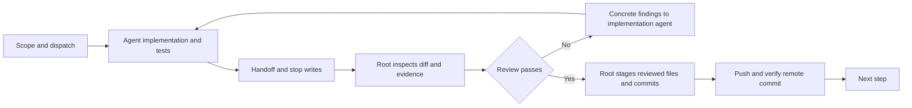

# Eight-step implementation and review workflow

Status: execution policy selected by the user. The detailed designs/specs were
committed as `11d36fa`. Steps 1–2 implement manual editing/save/reopen and
persistent bounded history; steps 3–8 remain pending. See
[step 1 evidence](validation/step-01.md) and [step 2 evidence](validation/step-02.md).
This document
formalizes dispatch/review/delivery and does not claim product implementation.

Read [AGENTS.md](../AGENTS.md), the [development workflow](development-workflow.md),
and the [stage/shared AI specs](specs/README.md). Previously confirmed product
decisions apply throughout; routine implementation and review corrections do not
require repeated user confirmation.

## 1. Roles and model configuration

The root agent is the scheduler, integrator, reviewer and delivery owner. It scopes
work, dispatches implementation, inspects actual changes, verifies evidence,
requests corrections, decides review outcome and alone commits/pushes accepted work.
Implementation agents own feature code, behavioral tests and implementation notes.
The implementation agent cannot approve its own delivery on behalf of the root.

Every subagent uses exactly these settings, as requested by the user:

| Setting          | Required value                                                     |
| ---------------- | ------------------------------------------------------------------ |
| Model            | `gpt-6.1-sol`                                                      |
| Reasoning effort | `high`                                                             |
| Context fork     | `none`, with a self-contained task brief and repository references |

Use a fresh implementation agent for each step. Corrections normally go back to
that step's existing agent with concrete findings. The root may split a large step
into smaller sequential assignments without changing its acceptance or commit gate.
Additional readers/auditors use the same explicit model/effort and have read-only
scope. If the requested model cannot be used, report that limitation; do not silently
substitute another model or effort.

Subagents do not stage, commit, push, merge, switch branches, create worktrees,
reset/discard work, or start other agents. They may edit only their assigned scope
and run appropriate local checks. They report unexpected dependencies, incompatible
contracts and product ambiguities to the root rather than expanding scope silently.

## 2. Checkout and execution discipline

Agents share one checkout. Default to one writing implementation agent at a time;
the eight steps proceed in the approved order. Schema generation, migrations,
dependency/lockfile changes and shared configuration writes are serialized. Readers
must not mutate files or run commands that regenerate outputs. All writers stop at
handoff before root review, final checks, staging, commit and push.

At each start, inspect/fetch repository state, preserve user changes and identify
the exact branch/base commit. Use a feature branch and the existing checkout.
Prefer the latest integrated `main` when prerequisites are there; if accepted
prerequisite work is still on the user's feature branch, retain that reviewed
dependency explicitly rather than silently dropping it. Root alone manages branch
transitions. This process does not create a permanent integration branch.

The current baseline is `feat/script-workbench`. Existing untracked `.agents/`
contains previously installed local interview skills; it is not part of feature
assignments or commits unless explicitly included. Keep runtime/test outputs in
ignored scratch locations and real user projects outside the source repository.

## 3. Approved step sequence

| Step | Assigned scope                                                                                                          | Reviewable outcome                                                                                |
| ---- | ----------------------------------------------------------------------------------------------------------------------- | ------------------------------------------------------------------------------------------------- |
| 1    | `S1-T01`–`S1-T06`: canonical model, migration/store, commands, editor and autosave                                      | User can write, save and reopen a manuscript with accurate save feedback                          |
| 2    | `S1-T07`–`S1-T08`: bounded persistent history and editor/keyboard routing                                               | Five grouped operations undo/redo correctly across reopening                                      |
| 3    | `S1-T09`–`S1-T13`: sources, intake/parsing, import, events, retention and recovery                                      | Complete manual manuscript foundation with S1 evidence and explicit platform gaps                 |
| 4    | `SAI-T01`–`SAI-T13`: global settings/credentials, runtime, durable execution/recovery and optional capability contracts | Generic caller works independently of manuscript types; no hidden retries or ambiguous redispatch |
| 5    | S2 main tasks through `S2-T14`; `S2-T13` real search integration is conditional                                         | Saved brief/outline and selected evidence produce one complete initial draft                      |
| 6    | `S3-T01`–`S3-T08`: anchors, comments, answers, candidates, comparisons and decisions                                    | User can review and accept/discard scoped changes, individually or atomically in a batch          |
| 7    | `S3-T09`–`S3-T15`: production locks, derived finalization, history, races and recovery                                  | Every mutation path protects user locks; complete S3 workflow has evidence                        |
| 8    | S4 tasks and complete cross-stage/shared AI evidence                                                                    | Clean copy/exports, verified recovery and actual platform/performance results                     |

Each step has internal task dependencies in its owning spec. Do not call a whole
stage complete merely because an earlier subset passed. Keep task and acceptance
status distinct from the eight delivery checkpoints.

`SAI-T14` is completed in parts: S2 integration during step 5, S3 integration during
step 6/7, and S4 evidence hooks during step 8. `SAI-T15` accumulates evidence as
behavior lands and closes after final applicable checks. Redaction, resource and
race tests belong alongside their implementation, not only at step 8.

Step 6 acceptance must already validate actual diffs, request/target versions,
scope, current claims and task reservations using the existing mutation-policy
seam. Step 7 installs production user locks; it is not permission to defer the
earlier acceptance safeguards. Similarly, conditional real search does not remove
the required unavailable-capability/manual-source path.

## 4. Dispatch brief and implementation handoff

The root supplies each assignment with:

- Step number, branch/base commit, relevant task/acceptance IDs and required specs.
- Concrete behavior, allowed files/modules, shared interfaces and completed inputs.
- Dependencies that remain pending, explicit exclusions and documented engineering defaults.
- Checks/fixtures needed for this step, expected failure/recovery cases and any
  external platform/provider evidence that must remain separately tracked.
- The prohibition on Git mutations, unapproved expansion and real-provider calls
  outside explicitly configured/authorized smoke verification.

The agent reads the actual repository and reports a handoff containing changed
files, implemented/partial task IDs, decisions/deviations, commands actually run,
results and acceptance mapping. It includes failures, skipped checks, tool/fixture
versions and remaining limitations. A passing summary is evidence to inspect, not
an automatic review decision. The agent leaves files ready for review without
committing or continuing to mutate them in the background.

## 5. Root review and correction loop

Use this loop for every step:

The root checks the final diff, new files, generated contracts/migrations and
dependencies against the assignment and spec. Review focuses on:

- Observable behavior and error paths, with no silent product-scope changes.
- Architecture ownership, especially sole core writes and AI/business separation.
- Stable IDs/revisions, atomic storage/receipts, history grouping, conflict handling
  and appropriate lock/reservation guards for the step.
- Meaningful behavioral evidence for restart, duplicate/stale receipts, cancellation
  and concurrency when touched, rather than only DTO-shape or happy-path checks.
- Localization/platform boundaries, secret handling, safe logs and controlled worker
  execution where those features are introduced.

Use `source scripts/cloud-env.sh` and the existing `pnpm check`, `pnpm build`,
`pnpm test:integration`, and `pnpm test:e2e` as applicable. Root independently checks
critical behavior/evidence; rerun relevant checks on the final corrected tree and
avoid pointless repetition when nothing changed. Use fake providers for ordinary
checks. A code review is not an independent human GitHub approval or proof of an
untested OS/provider capability.

Report findings with severity, file/location, concrete failure, expected behavior
and an acceptance/test reference. Return blocking issues to the implementation
agent and repeat until resolved. There is no fixed round count that turns an
unresolved failure into approval. Small integration changes by root, if necessary,
receive the same diff/validation gate; substantial implementation stays delegated.

`review_passed` requires resolved blocking findings, implemented assigned behavior,
passing required runnable checks, and explicit status for every assigned case.
Keep `passed`, `failed`, and `not_run` distinct. Native/provider cases unavailable
in the current environment remain open evidence and block the corresponding
readiness claim; do not label a stage fully accepted while required cases are open.
If a critical behavior cannot be established, mark the step blocked and explain
the concrete missing evidence instead of advancing on a guessed result.

## 6. Commit and push gate

Only root commits/pushes after review passes. Inspect the exact staged diff and
include only reviewed files, tests and relevant documentation. A file change after
review invalidates that approval until inspected/checked again. Do not include
local skills, credentials, generated runtime outputs or user work incidentally.

Normally produce one coherent English Conventional Commit per step; multiple
focused commits are acceptable only when each included change has passed review.
Record step/task/acceptance references and actual checks in the delivery evidence.
Push the feature branch without rewriting shared history, then verify its remote
commit equals the intended local commit. A failed/uncertain push remains delivery
pending; root resolves it without an automatic force push.

The user has authorized this implement/review/commit/push loop. Do not ask for
confirmation again for ordinary repairs, tests or the accepted step delivery.
Commit/push authority does not itself merge a PR, write directly to `main`, publish
an environment or release binaries. Follow the existing PR workflow for integration
and the user's actual instruction for merge/release.

## 7. Progress and durable evidence

Each step progresses through `pending`, `implementing`, `awaiting_review`,
`changes_requested`, `review_passed`, and `pushed`; use `blocked` when necessary.
Only `pushed` completes the code-delivery checkpoint and opens the next step.
Overall product/platform acceptance remains a separate evidence status.

Root records concise evidence under `docs/validation/step-<number>.md` as actual
implementation is verified: base commit, covered task/acceptance IDs, changed
behavior, test commands/outcomes, review corrections and external validation gaps.
Logs/screenshots belong in appropriate artifacts, not large inline transcripts.
Put the resulting commit in the delivery message/Git history rather than requiring
a report to contain its own future commit hash.

After each push, report the completed behavior, review/validation outcome, known
limits, branch/commit and next step. Continue the approved sequence without asking
for another routine go-ahead. The status and linked validation reports above track
the current implementation checkpoints.
