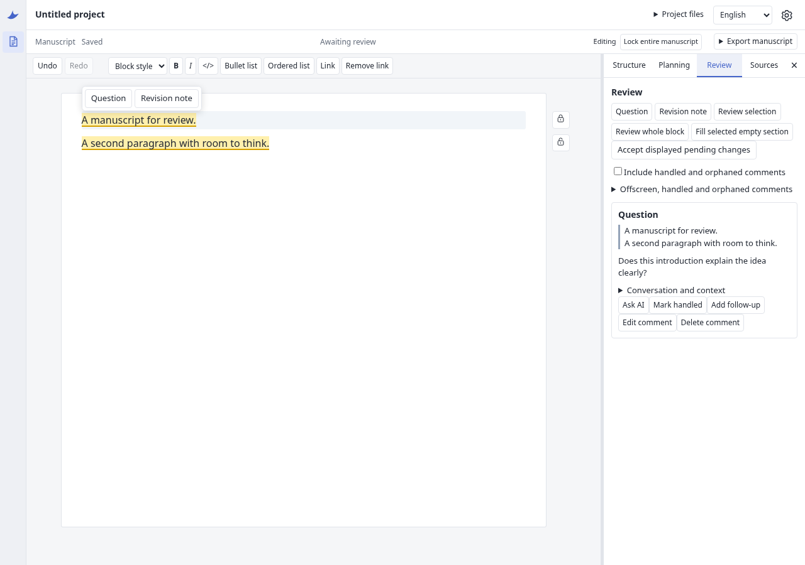
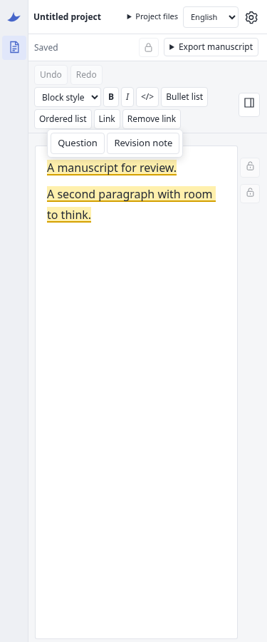

# Editor-first workspace validation

This report tracks the confirmed [EW-01–12 requirements](../design/editor-workspace.md)
on `feat/editor-workspace`, based on release `0567f24`. The private diagnostics
delivery is retained. Platform/provider/performance acceptance remains separate.

## Core and command foundation

The first actual canonical document edit atomically transitions an empty Outline
project to Draft in the same history entry and receipt. Empty/no-op edits do not
change stage or create history. Undo/Redo and reopen retain stable block identity
and monotonic revision tokens. Autosave adopts the acknowledged stage without
replacing later local text or composition state.

Planning saves and outline generation/adjustment work alongside a Draft. Initial
draft generation retains operation-specific Outline eligibility at prepare, start
and result application; late results cannot replace subsequent manual writing.
Blank outline headings may be saved as partial inputs, but generation/output
validation still requires complete headings. Existing language tags remain valid.

Implementation-agent checks passed on Linux with `scripts/cloud-env.sh` and
`CARGO_PROFILE_DEV_DEBUG=0 CARGO_PROFILE_TEST_DEBUG=0`:

- Domain and infrastructure libraries: 12 + 160 tests passed; an additional late
  initial-result safety test passed separately (infrastructure now has 161 tests).
- Autosave Node suite: 45 passed, including first-edit acknowledgement during
  later IME input and resolution of an ambiguous first receipt.
- Counted actual-SDK planning integration: one test passed with eight explicit
  provider calls. Draft planning saves/results preserved body, review, locks,
  approved baseline and finalized state, allowing expected working revisions to
  advance. Reopen preserved the same state.
- Service build, generated-contract checks, editor UI TypeScript, scoped formatting
  and whitespace checks passed. No protocol or storage migration was required.

Root reviewed the actual command/domain/controller changes and independently ran
the first-edit storage tests, first-edit autosave cases and contract checks before
committing this slice. The UI follow-up and integrated checks are recorded below.

## Shared editor workspace and input recovery

EW-01–12 are implemented in the shared React/Tiptap UI. The shell uses a 42px
workspace ribbon, bounded manuscript paper and a 320px auxiliary pane with
Structure, Planning, Review and Sources tabs. The pane supports keyboard tabs,
resizing, collapse, persisted browser preferences and a narrow-screen drawer.
The editor stays mounted in both stages; Planning stays mounted alongside Draft,
and inactive Review retains its composer. Selection actions use a portal and open
Review without losing the captured manuscript range. Paragraph locks stay at the
manuscript edge before the auxiliary pane. Export/copy/native delivery remain in a
compact disclosure, and project actions stay in the project menu.

The header aggregates body and planning state. Explicit error ownership gives an
unresolved body write priority over a plan error, including identical error codes.
A proven plan write followed by a failed planning read retries that read without
issuing a second SavePlanning. Known validation corrections resume automatic
saving; unsupported stored manuscript languages stay visible, while known Chinese
legacy aliases normalize to zh-CN. Recovery JSON requires Details. Discard requires
confirmation, retains buffers when cancelled, refuses ambiguous commands, preserves
the separate body buffer for plan-only discard, and fences stale reads with local
and shared history epochs. Planning/group-close commands retain later local body
input when their canonical body is unchanged. Fast initial draft completion still
uses the original changed-body/selection/IME applicability fences.

Linux checks completed by the UI implementation agent with
`scripts/cloud-env.sh`, exported `CARGO_PROFILE_DEV_DEBUG=0`,
`CARGO_PROFILE_TEST_DEBUG=0`, and the existing core binary:

- Controller suites: `node --import tsx --test tests/unit/autosave.test.mjs
tests/unit/planning-autosave.test.mjs` passed 66 cases. Coverage includes held
  receipts, composition, body/plan coexistence, known rejection correction,
  uncommitted ambiguous writes, stale discard reads, shared epoch changes, explicit
  error ownership and read-only recovery of an already committed plan.
- Editor UI TypeScript and the Web production build passed. The Web build retains
  Vite's existing large-chunk advisory; no framework or dependency was added.
- Targeted browser checks passed actual continuous typing over two seconds across
  multiple delayed save round trips, same DOM node/focus/end caret, first manual
  edit and Undo to the same empty Outline editor, reload, hidden Review selection
  actions, pane buffer retention, inline validation correction, discard cancel and
  confirmation, keyboard pane navigation/resize/close preferences and deferred
  formatting during synthetic body composition without taking Planning focus.
- The full manual/AI outline/draft/review/locks/source/import/export/native bridge
  flows are retained with workspace-aware selectors and geometry assertions.
  Provider tests use only the explicit counted mock SDK; no real provider was used.

Raw command logs are retained under `.artifacts/editor-workspace-unit.log`,
`.artifacts/editor-workspace-web-build.log`, and
`.artifacts/editor-workspace-e2e.log`. Intermediate logs remain separate from the
completed full run and final root verification.

Screenshots at 375, 768 and 1280 pixels are retained under
`.artifacts/editor-workspace-{blank,planning,draft-locks,review,sources,settings}-WIDTH.png`.
The validation error screenshot is
`.artifacts/editor-workspace-validation-error-1280.png`. Screenshots were inspected
for pane density, overflow, lock placement, readable manuscript measure and compact
controls. Selected final root screenshots are committed for review:

Real Windows/macOS IME, native credential stores and actual native lifecycle remain
unverified. Linux Chromium synthetic composition and browser bridge fixtures do
not establish those platform acceptance cases.

### Final UI candidate evidence

The second frozen full browser run passed **46 tests, with 3 existing opt-in
performance cases skipped**, in 2.8 minutes; see
`.artifacts/editor-workspace-e2e.log`. This includes released diagnostics, counted
planning/review SDK fixtures, editing/history/IME, import/sources, locks, clean
copy/export and the native delivery/close bridge fixtures. The preceding full
candidate log is retained separately as
`.artifacts/editor-workspace-e2e-before-review.log`.

After that full run, the final narrow fixes resume queued formatting after either
body or Planning composition ends, remove one duplicate error-owner assignment,
and normalize a known Chinese alias consistently after plan discard. The
controller suites still passed **66/66** and editor TypeScript passed. All three
affected browser cases passed in 12.4 seconds, including body/Planning composition
with deferred formatting and retained Planning focus, identical-code body/plan
error ownership, and validation/discard; see
`.artifacts/editor-workspace-final-scoped.log`. The final wording clarifies Retry
saving and Local planning copy in both catalogs. No Rust/core source changed in
the UI slice. Native Windows/macOS IME remains unverified.

## Independent root review and integrated verification

Root reviewed the core, UI composition, save controllers, selection handling,
locales, specifications and behavioral test changes. A separate read-only review
identified error-ownership and composition-action gaps; the final implementation
and regression cases resolve them. The delayed discard/navigation test confirms
that a later navigation waits for the planning queue; the additional shared epoch
fence also rejects a read crossing an independently changed history revision.

With implementation writes stopped, root completed these checks on Linux:

- `pnpm check`: passed contracts, formatting, workspace TypeScript, 186 Node tests,
  12 domain tests, 161 infrastructure tests, 4 service tests and Clippy with
  warnings denied. This preceded the final small composition-resume, normalization
  and wording follow-up; Rust/core sources did not change afterward.
- On the final source, contracts, repository formatting, workspace TypeScript and
  all **186 Node tests** passed again. `pnpm build` passed for Web, Electron and
  the Rust workspace. Logs: `.artifacts/editor-workspace-root-followup.log` and
  `.artifacts/editor-workspace-root-build-final.log`.
- `pnpm test:integration`: **10 passed**, including the counted planning flow with
  eight explicit provider calls and Draft planning/body/locks/baseline preservation.
  Log: `.artifacts/editor-workspace-root-integration.log`.
- `pnpm exec playwright test tests/e2e/editor-workspace.spec.ts`: **10 passed** in
  44.8 seconds on the final source. This independently covered continuous typing,
  delayed acknowledgements, synthetic body and planning composition, deferred
  formatting, retry ownership, validation correction, confirmed discard, pane
  preferences, retained review/planning buffers and responsive screenshots.
  Log: `.artifacts/editor-workspace-root-browser.log`.

No protocol, dependency, schema or migration change was needed. Empty outline
titles are now valid saved draft input; older binaries that reject such partial
plans may fail to read them. Audio/video workflows and native platform acceptance
remain outside this follow-up. The task branch targets `release/1.0.0`; this work
does not merge or deploy it.
