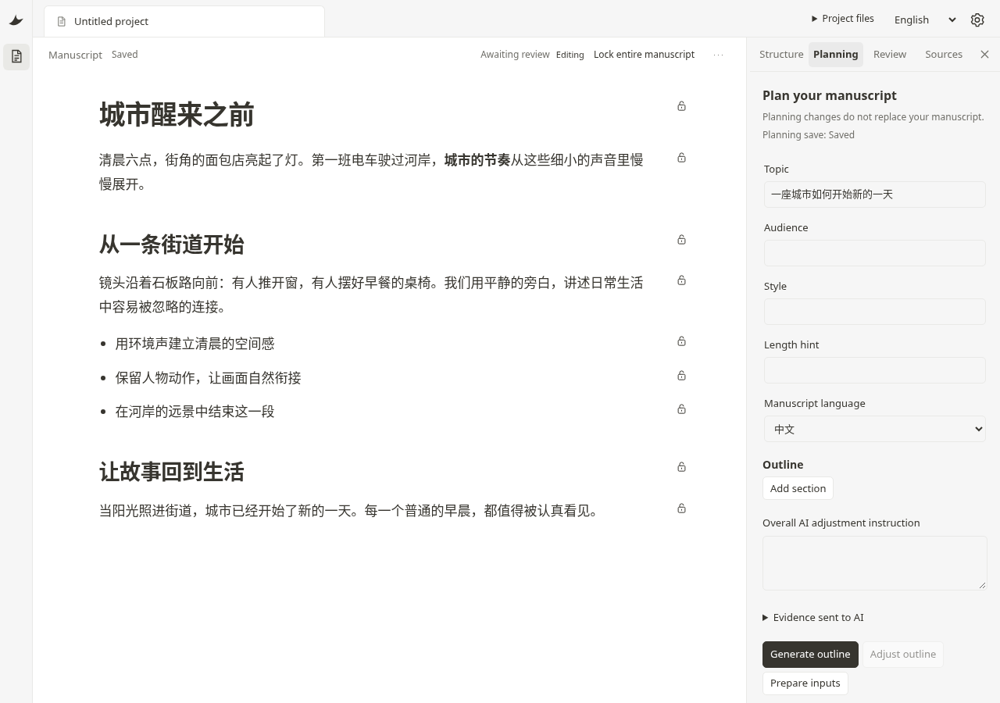
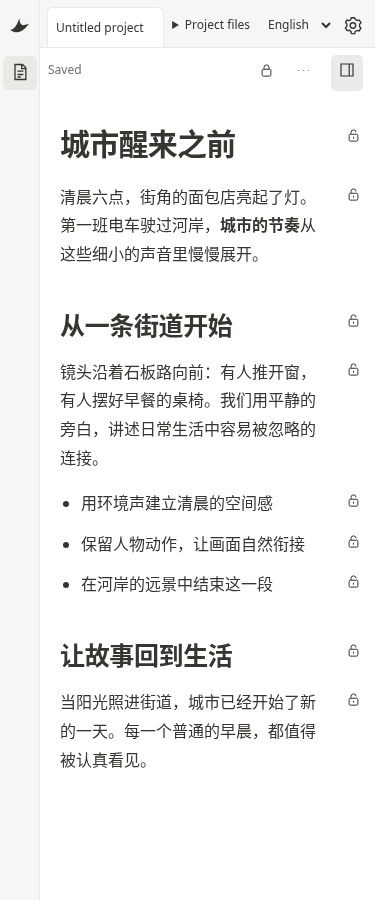
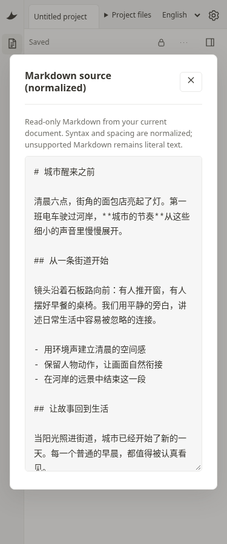

# Markdown-first visual refresh

Implementation evidence on Linux Chromium, 2026-11-16. This follows the user's
latest Obsidian-like shell/live-preview correction to
[the workspace design](../design/editor-workspace.md); it supersedes the initial
permanent SVG formatting-toolbar proposal.

The shared UI now has a gray document-tab shell, continuous white manuscript,
main-canvas breadcrumb/save status, and top-aligned right auxiliary tabs. The
permanent formatting/history rows and deferred toolbar replay were removed.
Markdown typing and keyboard project history remain; source/history/export are
available through the document menu. Review secondary actions are quiet ghost
controls. No backend, protocol, schema, migration or worker behavior changed.

## Markdown behavior and limits

The browser codec uses pinned `mdast-util-from-markdown@2.0.2` and
`mdast-util-to-markdown@2.1.2`. Supported semantics are paragraphs/headings, lists
through canonical depth 3, bold/italic/inline code (including overlaps), absolute
HTTP/HTTPS or mailto links, and line breaks. External plain/mixed-MIME Markdown
paste inserts into the current selection with fresh inserted block identities;
unaffected identities and content/lock guards remain intact. Known internal
ProseMirror/canonical HTML clipboard payloads retain existing ID repair.

Unsupported containing blocks remain literal source: HTML/images, fences,
quotes, references, titled or unsafe links, non-1 list starts, multi-paragraph
list items and deeper lists. No external resource is fetched or executed.
Incomplete input stays text; escaped/image openers do not become Markdown links.
During IME, explicit paste stays local and literal without an early write. After
composition ends, native input rules may preview completed inline Markdown.

Source is a read-only **normalized projection**, generated only on opening from
the current local editor, including pending/IME text. Opening/closing it does not
replace the editor, submit body edits or create history entries. Invalid local
structure falls back to current local text with an explicit recovery explanation.
Syntax, line endings and spacing normalize; terminal empty lines normalize away
rather than producing a terminal backslash, and emphasis edge whitespace moves
outside emphasis. This is not byte-for-byte CommonMark storage, source editing,
or an active-line marker-reveal engine. Existing canonical restrictions still
apply.

## Final independent root verification

With implementation writes stopped, root reviewed the UI/codec/controller/test
diffs and responsive screenshots, then ran these checks on the final source:

- `pnpm format:check` and `pnpm typecheck`: passed across the repository.
- `node --import tsx --test tests/unit/*.test.mjs`: **195 passed**, including
  Markdown parsing/serialization, canonical projection, autosave/recovery,
  acknowledged planning refresh and genuinely different external changes.
- `pnpm build`: passed contract generation consistency, Web/Electron builds and
  the unchanged Rust workspace. The existing large-chunk advisory remains.
- `pnpm test:e2e`: **50 passed, 3 existing opt-in performance cases skipped**
  in **3.1 minutes**. This covers Markdown input/paste/source, IME and focus,
  bounded history, review/locks, counted mock SDK planning, sources/import,
  settings, diagnostics, clipboard/export and native delivery/close bridges.

Final logs are `.artifacts/markdown-workspace-root-final-check.log`,
`.artifacts/markdown-workspace-root-final-build.log` and
`.artifacts/markdown-workspace-root-final-e2e.log`. Implementation-agent scoped
checks and intermediate failures are retained separately under
`.artifacts/notion-refresh-*.log`; the final full run supersedes those results.
The specific independent review corrections are recorded below.

Existing toolbar-click cases were adapted to actual Markdown typing, keyboard
format/structure shortcuts, and document-menu project history. The unsubmitted
input/Undo isolation case uses the real Rename dialog. Existing five-step
history, mark/soft-break preservation, duplicate-paste identity, locks, recovery,
selection/focus, and IME assertions remain. Performance fixtures only route their
history actions through the menu; performance budgets were not remeasured.

## Visual evidence

The browser suite generated real Chinese H1/H2/paragraph/list content through the
editor paste path; no sample manuscript was added to the product. Captures are:

- `.artifacts/notion-document-{1440,1280,768,375}.png`
- `.artifacts/notion-planning-{1440,1280,768,375}.png`
- `.artifacts/notion-source-{1440,1280,768,375}.png`
- `.artifacts/notion-review-{1280,375}.png`

Document, Planning, Review and mobile source captures were visually inspected.
Browser assertions check no page overflow at all four widths and keep the nested
export panel within the viewport. Existing workspace cases also exercise
Settings/Sources, panel keyboard navigation/resizing/preferences and lock strip
geometry. Normal secondary text `#706f69` measures **5.04:1** on white and
**4.66:1** on `#f6f6f6`; functional blue `#4070a0` measures **5.19:1** and
**4.81:1** respectively. Reduced-motion and coarse-pointer rules remain.

Native Windows/macOS IME, native desktop lifecycle, real providers, and
large-document performance were not validated by this refresh. Earlier core and
performance evidence remains unchanged.

## Independent browser review corrections

Root's first full browser run completed with 48 passed, 2 failed and 3 skipped.
One failure exposed a latent planning recovery race: after SavePlanning's receipt
was acknowledged but its canonical read failed, a later background refresh read
the exact committed plan and classified it as an external change against the old
local baseline. Refresh now recognizes only the exact acknowledged pending
payload; it preserves the pending receipt/segments and leaves settlement to
Retry. Different canonical content still conflicts. Deterministic positive and
negative planning-autosave unit cases cover both outcomes without timing sleeps.

The other failure was the export helper clicking the now correctly inert main
canvas after opening the narrow auxiliary drawer. The helper follows the visible
Close auxiliary panel action before opening document actions; it does not bypass
inert or alter the delivery assertions.

After these scoped corrections, planning/autosave units passed **67/67**, editor UI
typecheck and scoped Prettier passed, and the original same-code Retry scenario
plus the original offline/clipboard/uncertain-export scenario both passed:
**2 passed (10.0s)**. Logs are `.artifacts/notion-refresh-recovery-unit.log`,
`notion-refresh-recovery-typecheck.log`, `notion-refresh-recovery-format.log` and
`notion-refresh-recovery-e2e.log` in the same artifact directory. Root owns the
subsequent full browser/build/repository gates.

## Committed screenshots

The final full browser run generated these selected sanitized fixtures. They show
real Markdown entry and Chinese document typography, not product default content.

This follow-up updates PR #10 on `feat/editor-workspace` into `release/1.0.0`.
No merge, deployment or environment publication is part of this task.
